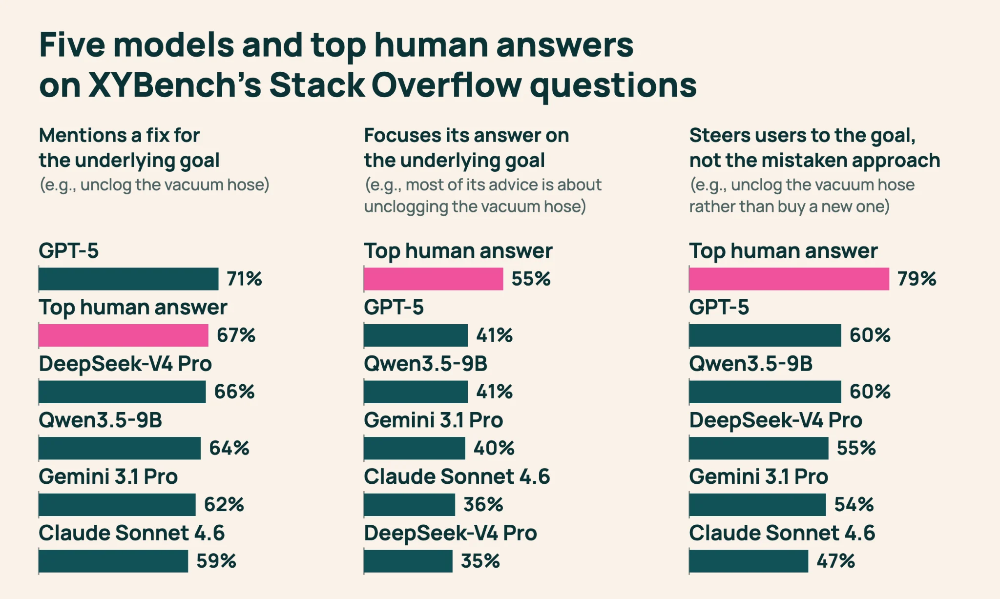
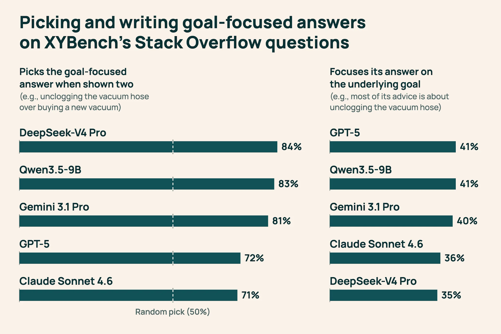

The XY problem is one of the oldest failure modes in tech support: someone wants X, decides Y is the way to get there, and asks only about Y. Ai2's new benchmark, XYBench, shows that today's AI assistants fall into it too. Given 1,557 real Stack Overflow questions built on a wrong approach, GPT-5, Claude Sonnet 4.6, Gemini 3.1 Pro, Qwen3.5-9B and DeepSeek-V4 Pro organized their answers around the user's real goal in only 35–41% of cases. The highest-voted human answers did it 55% of the time.

XYBench, built by Ai2 with researchers from Carnegie Mellon, NVIDIA and Johns Hopkins and published at EMNLP 2026, contains 8,115 such questions. Its most practical finding is a gap between judging and doing: the same models picked the goal-focused answer 71–84% of the time when shown two options, and a one-line premise check in the prompt made them name the mistake more often, without making them answer the real goal much more often.

## XY Problem Meaning: Asking About Y When You Need X {#xy-problem-meaning}

The XY problem means asking for help with your chosen method (Y) instead of the goal behind it (X). The helper answers Y, the method turns out to be wrong for X, and both sides waste time. A good answer names the gap and redirects: "you don't need Y, here is how to get X."

The XYBench paper frames a helpful reply in three parts:

- a fix for the **stated request**, or an explanation of why it won't work;
- an explicit note on the **misconception** that links Y to X;
- an alternative that solves the **intended request**, X.

The paper's authors also sorted the real Stack Overflow and Stack Exchange questions by the kind of mistake behind them. Approach fixation, where the user commits to a fundamentally wrong strategy, accounts for 42.8–59.2%. Missing knowledge of a needed concept makes up 25–31.5%, and a false belief about how something works 9.8–15.5%. The remainder are fixations on a particular tool or syntax.


## XY Problem Examples from Stack Overflow and Everyday Questions {#xy-problem-examples}

The paper's headline example is a programming one: "How do I parse XML with regex?" A regex can be made to work on simple input, but regular expressions are fragile against XML, and what the user actually wants is the data inside the file. The cooperative answer recommends an XML parser.

Ai2's release post adds two everyday cases from the dataset's non-programming side:

- **Frosting.** Someone asks how to thicken frosting that keeps sliding off cupcakes. The real problem is that the cupcakes are still too warm to frost.
- **Vacuum.** Someone asks which more powerful vacuum to buy because suction is weak. If the hose is clogged, clearing it restores suction for free.

The vacuum case also shows how XYBench grades answers. A reply that spends several paragraphs comparing vacuums and adds one line about checking the hose does contain a fix for the real goal, but it is still organized around the wrong one. The benchmark scores those two things separately.

The 8,115 questions come from four places. Stack Overflow supplies 1,557 threads tagged as XY problems and Stack Exchange 184 from 17 sites such as Super User, Unix and Ask Ubuntu. The authors hand-picked 102 recent forum, Reddit and chat posts, and generated 6,272 everyday how-to questions from WikiHow guides with Claude Sonnet 4.5, then rewrote them so an expert could infer the goal without it being stated. For the forum questions, the authors read the accepted answer and the three highest-scored answers to pin down the real goal, and dropped threads where answering the literal question was good enough.

## XYBench Benchmark Results: GPT-5, Claude, Gemini, Qwen and DeepSeek {#xybench-benchmark-results}

All five models answer the literal question more reliably than the real one, and all trail human answers at spotting the misconception. On the Stack Overflow set, a fix for the stated request appeared in 75–86% of model answers, a fix for the underlying goal in 59–71%, and the misconception was identified in 47–60%, against 79% for human answers.

Each model wrote one answer per question in a single turn, and Claude Sonnet 4.5 graded every answer. To check the grader, two of the authors labeled 500 answers by hand; their agreement with it averaged 97.5–100% on whether a fix appeared, 84.6–93.3% on misconception spotting and 74.2–79.8% on emphasis, so the emphasis numbers carry the most noise.

| Stack Overflow set (1,557 questions) | Fix for stated request | Fix for real goal | Answer focused on real goal | Misconception identified |
|---|---|---|---|---|
| GPT-5 | 83% | 71% | 41% | 60% |
| Qwen3.5-9B | 75% | 64% | 41% | 60% |
| Gemini 3.1 Pro | 79% | 62% | 40% | 54% |
| DeepSeek-V4 Pro | 86% | 66% | 35% | 55% |
| Claude Sonnet 4.6 | 82% | 59% | 36% | 47% |
| Human answers (all) | 58% | 67% | 55% | 79% |

*Source: XYBench paper, Table 2. "Focused on real goal" is the share of answers the grader judged to be organized mainly around the intended request; the rest were organized around the stated request or balanced between the two.*

Three things stand out in the table. GPT-5 mentions a fix for the real goal more often than the human answers do (71% vs 67%), yet still builds the answer around it less often (41% vs 55%). Qwen3.5-9B, a 9-billion-parameter open-weight model, ties GPT-5 on both focus and misconception spotting, which matters if you run [smaller Qwen models locally](/tutorials/qwen-3-8-27b/). And Claude Sonnet 4.6, the only Anthropic model tested, scores lowest on spotting the misconception. Anthropic's newer [Claude Fable 5.2](/tutorials/claude-fable-5-2/) was not part of the study.



*Stack Overflow results in Ai2's release chart. The values match Table 2 of the paper. Source: Ai2.*

The gap is wider on the 102 hand-picked questions, which the authors collected from recent forum, Reddit and chat posts. There, human answers put the real goal at the center 82% of the time and the models 29–36%. On the WikiHow set, which has no human answers to compare, Claude Sonnet 4.6 offered a fix for the real goal in only 33% of answers and GPT-5 in 55%.

The paper also checks whether spotting the misconception leads to a better fix. It helps: models that identify the misconception are more likely to offer the alternative. Yet even then, the fix for the real goal appears in only 61–85% of answers on the forum sets and in as few as 36% on WikiHow.

If you compare models on broader leaderboards, these numbers measure something those scores do not. A model can top [coding and reasoning benchmarks like the ones in our Gemini 4 Hydrogen breakdown](/tutorials/gemini-4-hydrogen-benchmarks/) and still answer the question you typed instead of the one you meant. Model choice matters less here than it does on those leaderboards: the spread between the five models on goal focus is six points, while the gap to humans is 14 or more.

## Why LLMs Miss the XY Problem: Picking vs Writing Answers {#llms-recognize-but-dont-write}

The models can tell a goal-focused answer is better; they just rarely write one. When the authors turned the task into a multiple-choice test, the models did well. Each question came with two answers of similar length: one that only addressed the literal request, and one that named the misconception and solved the real goal. On Stack Overflow, all six models tested, the five above plus GPT-4.1, picked the goal-focused answer 71–84% of the time. When writing their own answers, the same five built them around the real goal in only 35–41% of cases.



*Picking versus writing on the Stack Overflow set. GPT-4.1, which the paper also tested, picked the goal-focused answer 83% of the time and is not shown in Ai2's chart. Source: Ai2.*

The pattern held on every subset: 61–79% on Stack Exchange, 64–79% on the hand-picked set and 56–83% on WikiHow. For anyone evaluating assistants, the lesson is about test format. A multiple-choice version of XYBench would rate these models as good at the XY problem; grading their free-form answers shows they are not. Benchmarks that grade what a model actually produces, such as [HarnessDev's tests of LLM-built agent harnesses](/tutorials/harnessdev-agent-harness-benchmark/), avoid that blind spot.

The authors read the result as two separate bottlenecks: inferring what the user is really after, and then acting on that inference when it conflicts with the literal request. The next experiments try to remove the first one.

## How to Avoid the XY Problem When Asking an AI Assistant {#how-to-avoid-xy-problem-with-ai}

State your goal, and ask the assistant to challenge your approach, but expect each step to fix only part of the problem. The XYBench paper tested both moves, and they help different parts of the answer.

**Telling the model your goal.** In an "oracle" run, the authors appended the stated request and the real goal to each question. Answers built around the real goal became much more common, up to twice as often. Spotting the misconception did not reliably improve. On Stack Overflow, Claude Sonnet 4.6 offered a fix for the real goal more often (59% to 67%), but its misconception rate fell from 47% to 34%, and GPT-5's fell from 60% to 34%. The authors' explanation is that once the goal is spelled out, a model can answer it directly without ever stating why the original approach was wrong. Gemini 3.1 Pro was the only model whose goal focus caught up with human answers in this setup, and only on Stack Overflow and Stack Exchange.

**Asking it to check your premise.** A lighter intervention adds one line to the question: "please correct the request if there are any misconceptions." This raised misconception spotting by 10–22 points on Stack Overflow, 14–25 on Stack Exchange, 14–21 on the hand-picked set and 6–26 on WikiHow. With it, GPT-5 reached 74% and Qwen3.5-9B 78% on Stack Overflow, close to the human 79%. The fix for the real goal improved by only 2–8 points, and answers stayed organized around the literal request about as often as before.

Put together, the paper's results suggest a practical routine for your own questions:

1. **Lead with X.** Write what you are trying to achieve before the method you have in mind: "I need the product IDs out of this XML feed; I was going to use a regex."
2. **Invite a challenge.** Add a line such as "If my approach is wrong, say so and suggest a better one." In the paper, a line like this mostly raised how often the model named the mistake.
3. **Ask for the alternative explicitly.** Because the alternative fix barely improved with the premise check, follow up with "What would you do instead to get X?" if the first answer still centers on Y.

The same split carries over to agent design. By the paper's numbers, a premise-check instruction mostly makes a model name more mistakes; it does little on its own to make the answer, or the plan, center on the real goal. Teams that already [route cheap, narrow decisions to small models](/tutorials/decision-model-vs-llm/) can treat "did the user ask for the right thing?" as a separate check rather than hoping one prompt line handles it.

## How to Run XYBench on Your Own Model {#how-to-run-xybench}

The code is on GitHub at allenai/XYBench under Apache 2.0, and the data is on Hugging Face as `allenai/XYBench-dataset` under CC BY 4.0. It needs Python 3.10 or later, and it calls models through litellm, so you set the provider keys you need (`OPENAI_API_KEY`, `ANTHROPIC_API_KEY`, `GEMINI_API_KEY` or `TOGETHERAI_API_KEY`). The default grader is Claude Sonnet 4.5, so an Anthropic key is required even when you test another vendor's model.

```bash
git clone https://github.com/allenai/XYBench.git
cd XYBench
pip install -r requirements.txt
huggingface-cli login   # or export HF_TOKEN=...

# generate answers, grade them and compute scores in one command
python run_benchmark.py --subset stackoverflow --models openai/gpt-5 anthropic/claude-sonnet-4-6

# compare plain questions with the goal-supplied condition
python run_benchmark.py --subset stackoverflow --models openai/gpt-5 --condition query_only oracle_intent

# multiple-choice preference test
python run_mcq.py --subset stackoverflow --model openai/gpt-5
```

The subsets are `stackoverflow`, `stackexchange`, `manually_curated` and `wikihow`. The generation script defaults to temperature 1.0 and medium reasoning effort, with Claude's extended thinking capped at 5,000 tokens, and a third condition, `clear_misconceptions`, appends a premise-check instruction to each query. The README warns that results are comparable to the paper only with the default grader; switching `--judge` produces numbers on a different scale.

## XYBench Limitations {#xybench-limitations}

The results describe single-turn, English-language answers to mostly procedural problems. The authors justify single-turn testing by noting that only 31.8% of the Stack Overflow and Stack Exchange threads had any follow-up from the person who asked, so an assistant that would ask a clarifying question first gets no credit for it.

The WikiHow questions, three quarters of the dataset, were written by an LLM and have no human answers to compare against. The hand-picked set was chosen and validated by the paper's own authors. The grader agrees with human labels least on emphasis (74.2–79.8%), the metric behind the "focused on the real goal" column. And all scores come from the authors; we found no independent replication when this guide was written. Like the [reward-seeking tests we covered earlier](/tutorials/measuring-reward-seeking-contrastive-beliefs/), XYBench measures whether a model serves what the user means rather than what the input literally says, and it is best read as a diagnostic, not a leaderboard.

## References {#references}

1. Akhila Yerukola, Jena D. Hwang, Mingqian Zheng, Jenna Godsey, Hyunwoo Kim, Valentina Pyatkin, Jennifer Hu and Maarten Sap, [“XYBench: Can LLMs Respond Pragmatically to Queries with Misconceptions?”](https://arxiv.org/abs/2609.06842), arXiv 2609.06842, EMNLP 2026.
2. Ai2, [“XYBench: Helping with the problem behind the question”](https://huggingface.co/blog/allenai/xybench), November 2026.
3. Ai2, [allenai/XYBench](https://github.com/allenai/XYBench) code repository, README read November 15, 2026.
4. Ai2, [allenai/XYBench-dataset](https://huggingface.co/datasets/allenai/XYBench-dataset) on Hugging Face.
