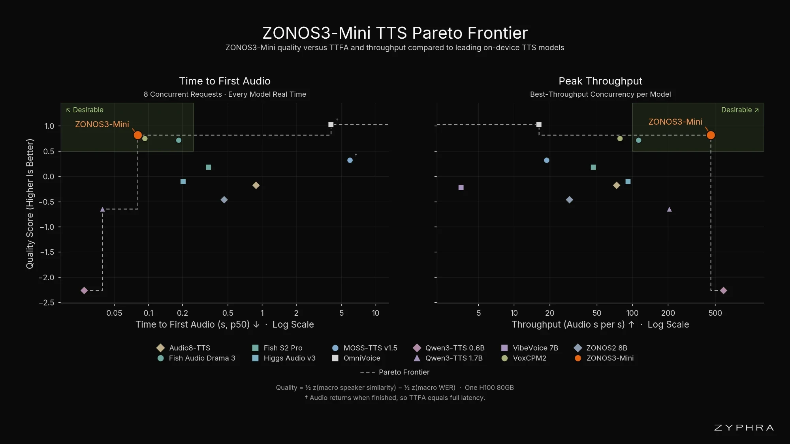
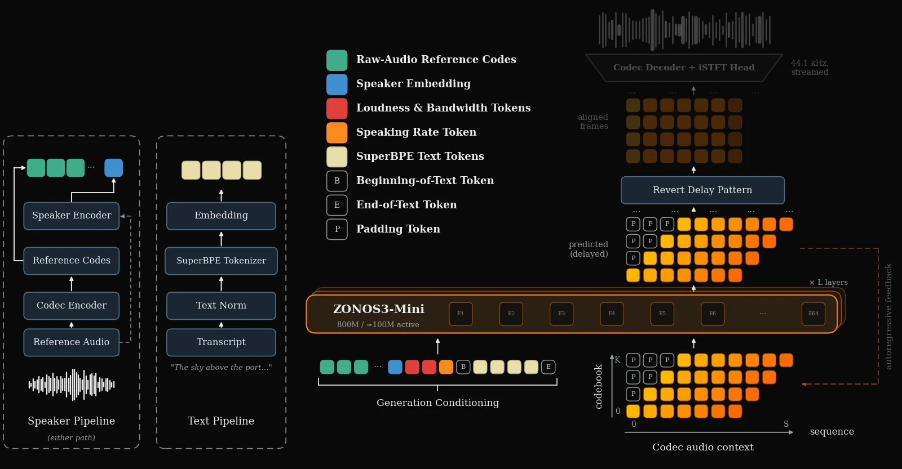
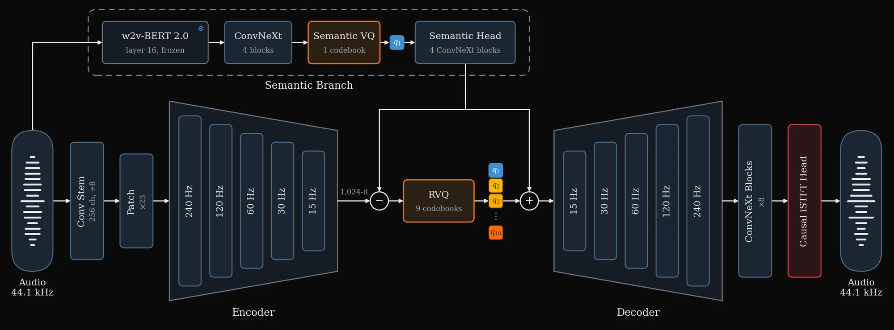

Zyphra's ZONOS3-Mini clones a voice with about 100 million active parameters, and in Zyphra's own benchmark it lands within reach of open TTS models many times its size. ZONOS3-Mini, released November 9, 2026 under Apache 2.0, is a mixture-of-experts text-to-speech model with 800 million total parameters that runs in a browser, on a Mac or on a server GPU. Its technical report scores it against a dozen open models and four closed systems; the gaps it leaves are mostly on noisy reference audio.

All scores here come from ZTTS2-Eval, a benchmark Zyphra built and ran itself. It pairs a prompt clip and a target sentence from different recordings of the same speaker, then scores the output for word error rate (WER, transcribed by Qwen3-ASR, or Whisper-large-v3 for English) and for speaker similarity with the ReDimNet verifier on a 0 to 100 scale. The clean half uses FLEURS-R read speech in 35 languages; the in-the-wild half uses VoxBlink2 recordings in 20 languages.

## ZONOS3-Mini Benchmarks vs Open-Source TTS Models {#zonos3-mini-benchmarks}

ZONOS3-Mini posts a macro WER of 6.71 and a speaker similarity of 81.2 on all 55 ZTTS2-Eval sets when it clones from a speaker embedding. Among open models, Fish Audio Drama 3 (4.74) and Zyphra's own ZONOS2 (6.22) have lower word error by more than a tenth of a point, and only OmniVoice and VoxCPM2 sound more like the reference speaker. The report splits systems by whether they receive the transcript of the reference clip, because that extra input helps cloning; ZONOS3-Mini does not use one.

| System | Params (total / active) | Reference transcript | Macro WER ↓ | Macro similarity ↑ |
|---|---|---|---|---|
| Fish Audio Drama 3 | 35B / 3B | Yes | 4.74 | 78.6 |
| ZONOS2 | 8B / 0.9B | No | 6.22 | 68.8 |
| OmniVoice | 0.6B | Yes | 6.62 | 83.1 |
| **ZONOS3-Mini, raw clip** | 886M / 100M | No | **6.70** | 69.8 |
| **ZONOS3-Mini, embedding** | 886M / 100M | No | **6.71** | **81.2** |
| Fish S2 Pro | 4.4B | Yes | 9.20 | 77.2 |
| MOSS-TTS v1.5 | 8B | No | 9.60 | 78.9 |
| VoxCPM2 | 2B | Yes | 9.80 | 83.1 |
| VoxCPM2 | 2B | No | 10.64 | 77.1 |
| Higgs Audio v3 | 4B | Yes | 10.60 | 75.8 |
| VibeVoice 7B | 7B | No | 12.24 | 76.1 |
| Qwen3-TTS 1.7B | 1.7B | No | 19.83 | 68.7 |
| Ground-truth recordings | – | – | 9.49 | 73.8 |

*Source: ZONOS3-Mini Technical Report, Table 4. WER is capped at 100% per utterance; Chinese and Japanese use character error rate. Selected rows; the full table also lists CosyVoice 3, Audio8-TTS and Qwen3-TTS 0.6B.*

Three readings of this table matter for a buying decision. First, several systems score a lower WER than the ground-truth recordings (9.49), so WER here measures how easily a speech recognizer understands the output; naturalness needs listening tests. Second, the Qwen3-TTS and CosyVoice 3 scores are depressed by language coverage: Zyphra ran every system on every language, and both officially support fewer than 55 sets. Third, ZONOS3-Mini's own predecessor, the 8B ZONOS2, still has slightly lower WER (6.22); the new model wins on similarity (81.2 vs 68.8 with embeddings) at roughly a ninth of the parameters.

Zyphra also fits an item-response-theory "capability index" over 420 metric, test-set and language items. It ranks ZONOS3-Mini first among open models, followed by Fish S2 Pro and MOSS-TTS v1.5. That index is Zyphra's own construction, so the raw WER and similarity columns are the easier numbers to compare with other reports.

## ZONOS3-Mini vs ElevenLabs and Cartesia {#zonos3-mini-vs-elevenlabs}

On clean read speech, ZONOS3-Mini's word error rate is close to the commercial APIs; on noisy in-the-wild prompts it is the least accurate system in the comparison. Zyphra tested four closed systems on ZTTS2-Eval Mini, a cheaper subset limited to German, English, Spanish and Chinese and to items every system generated.

| System | Voice | Clean WER ↓ | Clean similarity ↑ | In-the-wild WER ↓ | In-the-wild similarity ↑ |
|---|---|---|---|---|---|
| ElevenLabs v4 | Clone | 2.07 | 82.9 | 2.97 | – |
| Inworld TTS 2 | Clone | 2.42 | 71.5 | 3.89 | 61.4 |
| Cartesia Sonic 3.6 | Clone | 2.49 | 85.0 | 3.30 | 76.4 |
| Gemini 3.8 Flash | Preset | 2.55 | – | 4.67 | – |
| ZONOS3-Mini, embedding | Clone | 2.55 | 83.1 | 5.00 | 77.5 |
| ZONOS3-Mini, raw clip | Clone | 2.56 | 75.5 | 5.86 | 58.1 |

*Source: ZONOS3-Mini Technical Report, Table 5. A dash means the score was not reported. Gemini 3.8 Flash uses preset voices, so it has no similarity score.*

Cartesia keeps the best clean-speech similarity (85.0 against 83.1), and ZONOS3-Mini's embedding mode has the highest in-the-wild similarity of the systems that report one. If your reference clips are studio-quality, the gap to ElevenLabs is about half a WER point; if they come from phone calls or user uploads, expect noticeably more word errors than the paid APIs. The comparison is Zyphra's own and covers only four languages.

## ZONOS3-Mini Latency and Throughput Benchmark {#zonos3-mini-latency}

On a single H100 80GB, ZONOS3-Mini returned first audio in a median 80 ms with 8 concurrent requests and peaked at 457 seconds of audio generated per second. Zyphra's Pareto chart places it on both frontiers against the same open models as the accuracy table, with quality defined as half the z-score of macro similarity minus half the z-score of macro WER.



*Quality versus median time to first audio at 8 concurrent requests (left) and versus peak throughput at each model's best concurrency (right), one H100 80GB. Image by Zyphra. Systems marked † return audio only when finished, so their time to first audio equals full latency.*

The report gives other numbers measured under different settings, and they should not be mixed with the chart:

| Setting | Result | Source |
|---|---|---|
| H100, 8 concurrent requests | 80 ms median time to first audio | Model card chart |
| H100, best concurrency | 457 s of audio per second | Model card chart |
| H100 server, streamed prefix decode | First audio bytes 0.25 to 0.36 s after the request | Report, Section 9 |
| H100, 128 concurrent requests, whole-clip decode | 67 s of audio per second | Report, Section 9 |
| H100, quantized GGUF, one stream (ggml) | About 20 s of audio per second | Report, Section 9 |
| CPU, quantized GGUF (ggml) | 129 to 160 frames per second | Report, Section 9 |
| Browser (WebGPU), Pixel 9 / M3 MacBook Air | Real time; first audio under 800 ms / under 450 ms | Report, Section 9 |

At 15 codec frames per second of audio, the CPU figure works out to roughly 8.6 to 10.7 times real time; the report does not name the CPU. Zyphra's launch post gives faster browser figures than the report, under 570 ms on the Pixel 9 and under 150 ms on the M3 MacBook Air, without saying what changed, so measure on your own target device before you promise a latency budget. For a voice agent, time to first audio is one leg of the round trip, next to transport, speech recognition and the language model; our piece on [real-time voice agents as distributed systems](/tutorials/real-time-voice-agents-distributed-systems/) breaks down where the rest of the budget goes.

## ZONOS3-Mini Voice Cloning: Speaker Embedding vs Reference Clip {#zonos3-mini-voice-cloning}

For most cloning jobs, the speaker-embedding mode is the safer default: it keeps similarity high when the reference audio is noisy, where the raw-clip mode drops sharply. ZONOS3-Mini accepts a voice in two forms. A raw reference clip of up to 60 seconds is encoded into codec tokens and placed in front of the text, with no transcript needed. Alternatively, the clip is reduced to a single 192-dimensional MECT-B2 speaker embedding.

| Post-trained model, CFG 1 | Clean WER | Clean similarity | In-the-wild WER | In-the-wild similarity |
|---|---|---|---|---|
| Speaker embedding | 7.79 | 83.4 | 4.81 | 77.3 |
| Raw reference clip | 7.39 | 76.5 | 5.48 | 58.1 |

*Source: ZONOS3-Mini Technical Report, Table 3, all 55 ZTTS2-Eval sets.*

On clean read speech the two modes are close, with the raw clip slightly more intelligible. On in-the-wild prompts the raw clip loses 19 similarity points. Zyphra's launch post describes the trade-off: the in-context clip gives more natural output but does not copy prosody exactly, while the embedding is a compressed, controllable representation that the voice-design sliders (age, gender presentation, texture) act on. The report adds that Zyphra kept the raw-clip path because it expects that channel to scale better in larger models. The DPO and GRPO post-training stages helped both modes most on noisy prompts, cutting in-the-wild WER from 7.52 to 4.81 for embeddings and from 12.57 to 5.48 for raw clips.

## ZONOS3-Mini Architecture: Why 100M Active Parameters Run in Real Time {#zonos3-mini-architecture}

ZONOS3-Mini is fast mainly because it predicts audio at 15 frames per second instead of the 86 Hz codec ZONOS2 used, and because each token touches only about 100M of its 800M parameters. The backbone has 11 layers at width 1,024: nine Gated DeltaNet layers and two global attention layers, the same 3:1 hybrid pattern recent language models use, as in [Qwen 3.8 27B](/tutorials/qwen-3-8-27b/). Every layer after the first routes through a latent mixture of 64 experts with top-2 routing, the same total-versus-active trade-off that large language models such as [Inkling 2 Small](/tutorials/inkling-2-small/) use at a far bigger scale. The context window is 32,768 positions, enough for up to 10 minutes of audio in one generation.



*Inference pipeline: either speaker path, the text pipeline and the control tokens feed the mixture-of-experts backbone, which predicts ten codebooks per frame under a delay pattern. Final frame of Zyphra's animated diagram. Image by Zyphra.*

The codec, Zyphra Audio Codec 1 (ZAC-1), turns 44.1 kHz audio into 15 Hz frames of ten codes each: one semantic codebook distilled from a frozen w2v-BERT 2.0 model and nine acoustic codebooks. A causal iSTFT head turns each frame back into audio as soon as its last code is generated, which is what makes streaming possible. Zyphra reports that, with the same training data, a TTS model trained on ZAC-1 reaches a tenth of the word error rate of one trained on the Descript Audio Codec.



*ZAC-1: a semantic branch and nine residual codebooks at 15 Hz, decoded by a causal iSTFT head. Image by Zyphra.*

## ZONOS3-Mini Quantization and Hardware Requirements {#zonos3-mini-quantization}

ZONOS3-Mini's quantized GGUF files range from 1.03 GB at Q8_0 down to 0.66 GB with 4-bit experts trained with quantization-aware training (QAT), and that 4-bit QAT format showed no measurable loss of intelligibility in Zyphra's test. The method matters more than the bit width:

| Format (375k-step checkpoint) | WER, four-language in-the-wild set | Change vs BF16 |
|---|---|---|
| BF16 | 4.14 | – |
| Q8_0 mixers, post-training quantization (PTQ) | 4.27 | +0.14, not significant |
| 4-bit experts + Q8_0 mixers, QAT | 4.21 | +0.07, not significant |
| 4-bit experts + Q8_0 mixers, PTQ | 4.68 | +0.54 |
| 2-bit experts, QAT | 4.97 | +0.83 |
| FP8 W8A8, QAT | 4.54 | +0.40 |
| FP8 W8A8, PTQ | 5.11 | +0.97 |
| Ternary experts | 7.05 | +2.91 |

*Source: ZONOS3-Mini Technical Report, Table 8. Measured on an English, Chinese, Japanese and Korean in-the-wild set at CFG 1; the change column is a paired bootstrap difference.*

FP8 is the trap here: it raised WER and, according to the report, increased throughput by at most 3%. On a GPU server, BF16 is the reference; on laptops and phones, use the published GGUF and WebGPU builds, which Zyphra says all pass its internal quality thresholds.

Memory needs depend on the runtime rather than on the model alone. The CUDA server downloads about 9 GB of PyTorch weights (language model, codec and speaker encoders), targets CUDA 12.8 and is tested on H100; on pre-Hopper GPUs such as the A100 it switches to portable Triton kernels. Its default configuration gives half of the GPU's memory to the KV cache so the codec fits alongside, which likely explains why MindStudio's hands-on review saw about 25 GB in use on a 48 GB card. Treat that reading as a property of the server setting. The GGUF files that run on CPUs and phones are under 1.1 GB.

## How to Run ZONOS3-Mini Locally: Browser, SGLang, MLX or ggml {#run-zonos3-mini-locally}

The fastest way to try ZONOS3-Mini is the in-browser build: it runs on your own GPU through WebGPU with nothing to install, and the browser caches the model after the first download. For a server, SGLang-Omni and Zyphra's own runtimes both expose an OpenAI-compatible `/v1/audio/speech` endpoint, so code written for OpenAI's speech API needs only a new base URL.

| Machine | Runtime | Notes |
|---|---|---|
| Any WebGPU browser | Zonos Voice Studio or the Lite page | No install; first visit downloads the model |
| Linux + NVIDIA GPU | SGLang-Omni (`sgl-omni serve`) | Streaming and cloning from a reference clip |
| Linux + NVIDIA GPU | Zyphra CUDA server on Mini-SGLang | Tested on H100; CUDA 12.8; first start compiles kernels for several minutes |
| Apple Silicon Mac | Zyphra MLX server | Uses the GGUF files |
| CPU, CUDA, Metal or Vulkan | Zyphra C++/ggml server and CLI | No Python at runtime |

With SGLang-Omni installed, one command starts a server, and a curl request returns a WAV file:

```bash
sgl-omni serve --model-path Zyphra/ZONOS3-Mini --port 8000

curl -X POST http://localhost:8000/v1/audio/speech \
  -H "Content-Type: application/json" \
  -d '{"input": "Hello from ZONOS3-Mini!"}' \
  --output output.wav
```

Adding `"references": [{"audio_path": "<reference clip>"}]` clones a voice, and `"stream": true, "response_format": "pcm"` streams 44.1 kHz audio as it is generated. Zyphra's own servers listen on port 1919, ship 27 default voices, and add a native `/v2/generate` endpoint that takes either a base64 reference clip or a stored speaker embedding, plus the steering controls described below. They share one HTTP contract, so you can prototype on an M-series Mac and move to a CUDA box without changing client code.

One packaging detail affects speech editing: on the CUDA server, the speech-edit LoRA lives in a private Zyphra repository, while the MLX and ggml servers load it from the public `backbone-ptq-edit.gguf` file. If you need editing on NVIDIA hardware today, the ggml server with CUDA is the documented public route.

## ZONOS3-Mini Languages: 43 Supported, Nine Normalized {#zonos3-mini-languages}

ZONOS3-Mini supports 43 languages, but only nine get automatic text normalization: English, Mandarin, Japanese, Korean, German, Spanish, French, Italian and Portuguese. Text in the other 34 languages passes through as written, so digits, dates, currency and abbreviations should be spelled out before synthesis.

The supported list covers the main Western, Northern and Eastern European languages, Turkish, Arabic, Hebrew and Georgian, Mandarin, Japanese and Korean, five Southeast Asian languages and eleven South Asian ones, from Hindi and Bengali to Odia and Urdu. The ZTTS2-Eval scores above average 35 clean and 20 in-the-wild language sets, so per-language quality can sit well above or below the macro figure; the report's appendix lists every language.

MindStudio's hands-on review found the same unevenness by ear. English, Spanish, Portuguese and Italian came out clean, including a paragraph full of numbers, an email address and a tongue-twister. A cloned English voice carried into Telugu reasonably well. An Irish-accented English voice and a Mandarin voice kept the speaker's texture but sounded "plasticky" in pronunciation and delivery. If your product targets one language or accent, test that pairing before committing.

## ZONOS3-Mini Voice Control: Accents, Emotion and Their Limits {#zonos3-mini-voice-control}

ZONOS3-Mini can steer age, gender presentation, texture, accent, emotion, pace, projection and liveliness, but stronger settings cost intelligibility and some controls do not engage for every voice. Identity controls move the speaker embedding along learned directions. Delivery controls use training-free activation steering: a vector added at layer 9 for the whole line, or only on chosen words, tracked by alignment attention heads during streaming.

The report quantifies the cost for accents. Each of 14 accents has its own rank-64 LoRA adapter of 8.9M parameters. At full strength the adapters raise the rate at which a classifier hears the target accent from 0.126 to 0.393, while English WER climbs from 3.71 to 14.26. At 0.7 strength, every adapter keeps WER near 6%.

Zyphra is candid about the delivery controls as well. Its launch post calls the emotion settings targets that do not guarantee a specific emotion, and notes that pace steering can also change loudness and pitch. In the report's calibration, the three default voices passed most of the 12 emotion and delivery poles, and the positive delivery poles were the ones disabled most often. For narration or game dialogue, budget time to tune values per voice.

## Should You Use ZONOS3-Mini? {#should-you-use-zonos3-mini}

ZONOS3-Mini makes a good case for running voice cloning on the device, with accuracy that Zyphra's report places near commercial APIs on clean speech. Choose by where the audio runs and how clean your reference clips are.

- **On-device or in-browser speech:** ZONOS3-Mini is built for this. The weights are Apache 2.0, the runtimes MIT, and the 0.66 GB 4-bit QAT build kept BF16 intelligibility in Zyphra's test.
- **Server TTS for a voice agent:** the 80 ms median first audio at 8 concurrent requests on one H100 is a strong starting point. Route between it and a hosted voice the way you would between text models, for example behind a [model gateway](/tutorials/model-gateway-enterprise-ai-control-plane/).
- **Lowest word error regardless of size:** Fish Audio Drama 3 led every open system on WER, at 35B total parameters.
- **Noisy user-uploaded reference audio:** use the embedding mode, and compare against ElevenLabs or Cartesia, which kept lower in-the-wild WER in Zyphra's own table.
- **A language outside the nine normalized ones, or a specific accent:** test it first; quality varies more there than the macro numbers suggest.

Teams already self-hosting open models can reuse the same sizing habits we described for [MiniMax H3 Image](/tutorials/minimax-h3-image-vs-p-h3-image/): pick the runtime by hardware, then measure on your own prompts before trusting a vendor chart.

## ZONOS3-Mini FAQ {#zonos3-mini-faq}

### Is ZONOS3-Mini the best open-source text-to-speech model in 2026?

On Zyphra's own ZTTS2-Eval benchmark it has the highest speaker similarity among systems that clone without a reference transcript, and Zyphra's capability index ranks it first among open models. Fish Audio Drama 3, a much larger 35B-total model, has lower word error, and OmniVoice and VoxCPM2 score higher on similarity. No independent benchmark had been published by November 14, 2026.

### How many languages does Zonos TTS support?

ZONOS3-Mini supports 43 languages, from English and the main European languages to Mandarin, Japanese, Korean, Arabic, Hebrew, Thai, Vietnamese and eleven South Asian languages. Built-in text normalization covers only nine of them, so numbers and dates in the others should be written out.

### Does Zonos TTS have an API?

Yes. Zyphra hosts ZONOS3-Mini on Zyphra Cloud, and every self-hosted runtime exposes an OpenAI-compatible `/v1/audio/speech` endpoint plus Zyphra's native `/v2/generate` endpoint for voice cloning, streaming and steering.

## References {#references}

1. Gabriel Clark, Sofian Mejjoute, George Close and Beren Millidge, [ZONOS3-Mini Technical Report](https://arxiv.org/abs/2611.16525), arXiv 2611.16525, November 2026.
2. Zyphra, [ZONOS3-Mini launch post](https://www.zyphra.com/our-work/zonos3-mini), November 9, 2026.
3. Zyphra, [ZONOS3-Mini model card](https://huggingface.co/Zyphra/ZONOS3-Mini), Hugging Face, accessed November 14, 2026.
4. Zyphra, [ZONOS3-Mini runtimes README](https://github.com/Zyphra/ZONOS3-Mini), GitHub, accessed November 14, 2026.
5. MindStudio, [Zonos 3 Mini TTS Review: 43 Languages, Voice Cloning, Hands-On Test](https://www.mindstudio.ai/blog/zonos-3-mini-tts-review), November 14, 2026.
